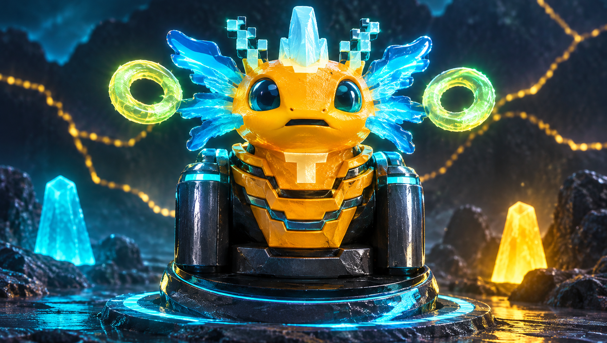
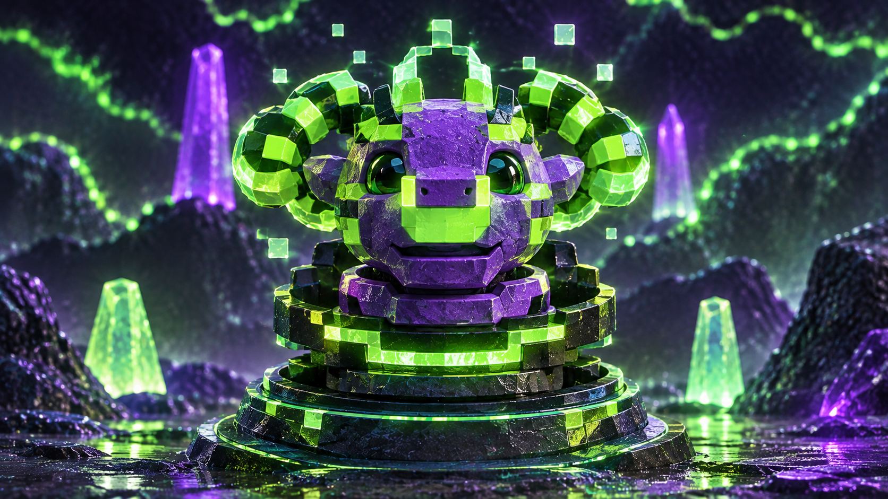
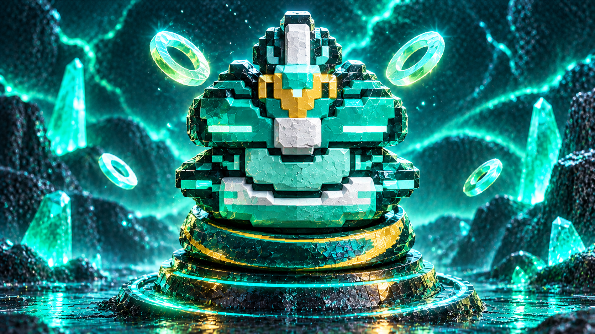
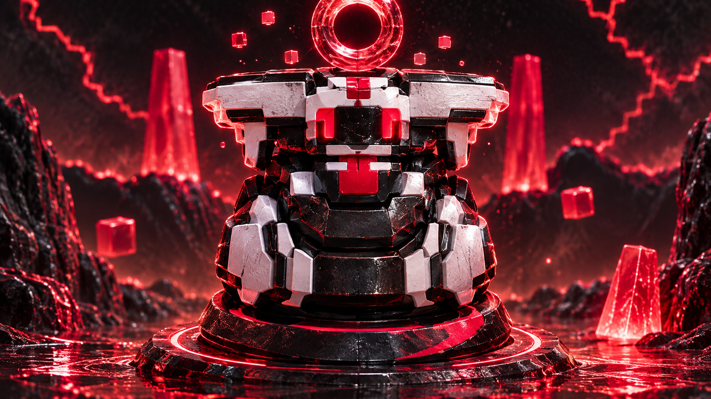
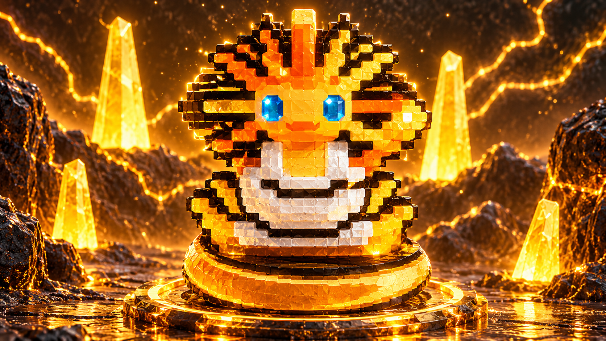
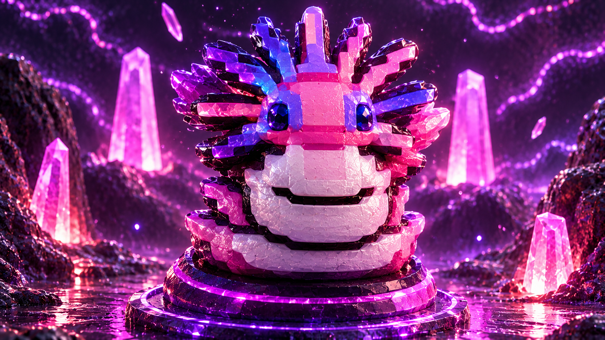
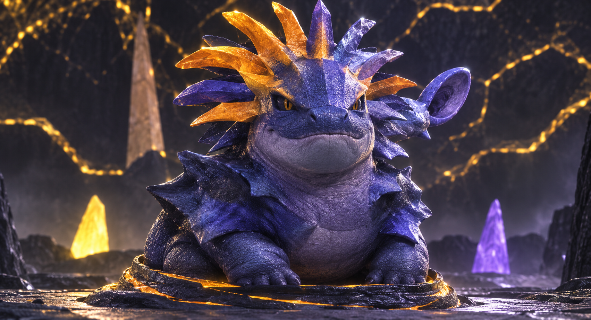

# PixelForge Virtual Creatures

**PixelForge Virtual Creatures** é um jogo *mobile-first* de **criação, cuidados em tempo real, evolução orgânica e reprodução genética P2P offline de dinossauros elementais**, construído com **pixel art determinística `32×32`**, **cenários 3D interativos em Babylon.js** e empacotamento nativo para **Android (Capacitor)** e **Web**.

Você inicia sua jornada recebendo um **ovo ancestral misterioso** no Santuário Elemental, acompanha sua eclosão e cuida do seu dinossauro ao longo de um **ciclo de vida completo de 30 dias (`720 horas`)** — alimentando-o conforme sua dieta biológica, treinando em seu habitat 3D, tratando enfermidades, alcançando a maturidade adulta e cruzando criaturas com outros jogadores via **Bluetooth / Wi-Fi P2P (Google Nearby Connections)** para gerar novos ovos com DNA herdado, mutações e uma coleção própria de dinossauros.

> Para um guia detalhado com tabelas completas de itens, atributos, doenças, compatibilidade genética e mecânicas internas, consulte [`docs/GAME_GUIDE.md`](docs/GAME_GUIDE.md).

---

## Objetivo do Jogo

1. **Incubar o Ovo Inicial (`02:00` min):** Ao iniciar um novo save, um entre os **11 dinossauros elementais** é sorteado como ovo ancestral (`ovo`). Após 2 minutos reais de espera e animação de rachadura em 4 quadros, o filhote nasce (`baby`).
2. **Manter o Dinossauro Saudável em Tempo Real:** Mesmo com o aplicativo fechado, o tempo continua passando (`ClockPort`). As necessidades diminuem a cada hora e exigem atenção constante para evitar doenças e manter a felicidade alta.
3. **Evoluir nas 6 Fases da Vida (`30 dias / 720h`):** Cumprindo idade mínima, nível de experiência (XP), saúde, felicidade e ausência de doenças ativas, sua criatura evolui organicamente por **`ovo` → `baby` → `crianca` → `pre-adolescente` → `adolescente` → `adulto`**.
4. **Reproduzir via P2P e Expandir Sua Coleção:** Conecte dois dispositivos próximos pelo **Google Nearby Connections** no Android (ou duas abas no navegador via `BroadcastChannel`) na aba **🧬 Genética**. O cruzamento executa um protocolo criptográfico **Commit-Reveal SHA-256** que sorteia de forma justa qual jogador recebe o ovo único da rodada, grava a linhagem na **Árvore Genealógica** e permite incubar, chocar e alternar livremente entre todos os dinossauros da sua coleção (`🐉` no cabeçalho ou na aba **Ficha**).
5. **Preservar o Legado (Chama Ancestral):** Ao completar o ciclo natural de 30 dias (`720h`), o dinossauro pode reencarnar em um novo ovo ancestral pela **Chama do Santuário** (`Reviver`).

---

## Os 11 Dinossauros Elementais (`examples/`)

Cada espécie possui paleta própria, habitat 3D dedicado em Babylon.js, sistema exclusivo de partículas, temperamento, dieta biológica (favoritos, aceitos e proibidos) e **54 quadros declarativos `32×32` em JSON** (6 estágios de vida × animações de `eclosao`, `idle`, `comendo`, `amando`, `doente` e `morte`, totalizando **594 arquivos JSON** em `examples/`). Os 10 primeiros também contam com artes conceituais de referência em alta resolução dentro de `examples/<espécie>/`:

### 🔥 Ignisauro (*Ignisaurus Rex*)

- **Arte de referência:** [`examples/ignisauro/Ignissauro.png`](examples/ignisauro/Ignissauro.png) · **Sprites:** [`examples/ignisauro/`](examples/ignisauro/README.md)
- **Elemento & Habitat:** Fogo e Magma Vulcânico (`fire`) · *Caldeira Vulcânica Ancestral* (brasas ascendentes `#fb923c` / `#fde047`)
- **Perfil:** Terópode pré-histórico de escamas terracota, coroa de cristais/chamas esmeralda e núcleo de magma vivo; *Guardião Impulsivo da Caldeira* (`ferocious`).
- **Cuidados:** Favorito **Pernil Vulcânico Assado** · Atividade favorita **Corrida nas Rochas Quentes** · **Proibidos:** *Fruta-Cristal da Tundra* e *Cogumelo Bioluminescente*.

### ❄️ Glacissauro (*Cryosaurus Glacius*)

- **Arte de referência:** [`examples/glacissauro/Glacissauro.png`](examples/glacissauro/Glacissauro.png) · **Sprites:** [`examples/glacissauro/`](examples/glacissauro/README.md)
- **Elemento & Habitat:** Gelo e Cristal Criogênico (`ice`) · *Santuário da Geleira Eterna* (cristais de gelo em queda suave `#38bdf8`)
- **Perfil:** Encouraçado glacial de escudo craniano hexagonal com pontas de gelo e três chifres cristalinos; *Sentinela Serena da Tundra* (`stoic`).
- **Cuidados:** Favorito **Fruta-Cristal da Tundra** · Atividade favorita **Meditação Cristalina** · **Proibidos:** *Pernil Vulcânico Assado* e *Cogumelo Bioluminescente*.

### ⚡ Electrossauro (*Fulgursaurus Rex*)

- **Arte de referência:** [`examples/electrossauro/Electrossauro.png`](examples/electrossauro/Electrossauro.png) · **Sprites:** [`examples/electrossauro/`](examples/electrossauro/README.md)
- **Elemento & Habitat:** Eletricidade e Tempestade Galvânica (`electric`) · *Pico dos Para-Raios de Basalto* (centelhas voltaicas `#fde047` / `#22d3ee`)
- **Perfil:** Predador dourado-âmbar com babado lateral elétrico ciano e armadura condutora; *Velocista Galvânico* (`energetic`).
- **Cuidados:** Favorito **Fruta-Trovão de Plasma** · Atividade favorita **Circuito de Relâmpagos** · **Proibidos:** *Geodo Crocante de Esmeralda* e *Fruto Abissal de Rubi*.

### ☠️ Toxissauro (*Venomousaurus Titan*)

- **Arte de referência:** [`examples/toxissauro/Toxissauro.png`](examples/toxissauro/Toxissauro.png) · **Sprites:** [`examples/toxissauro/`](examples/toxissauro/README.md)
- **Elemento & Habitat:** Veneno e Bioluminescência Ácida (`poison`) · *Pântano Bioluminescente de Turfa* (bolhas ácidas ascendentes `#a3e635` / `#a855f7`)
- **Perfil:** Titã violeta com padrões verde-limão fluorescentes, chifres bioluminescentes e ferrão caudal; *Alquimista do Pântano* (`curious`).
- **Cuidados:** Favorito **Cogumelo Bioluminescente** · Atividade favorita **Exploração Bioluminescente** · **Proibidos:** *Pêssego Solar Dourado* e *Fruta-Cristal da Tundra*.

### 🌿 Terrassauro (*Geosaurus Titan*)

- **Arte de referência:** [`examples/terrassauro/Terrassauro.png`](examples/terrassauro/Terrassauro.png) · **Sprites:** [`examples/terrassauro/`](examples/terrassauro/README.md)
- **Elemento & Habitat:** Terra e Cristal de Esmeralda (`earth`) · *Cânion Monolítico de Esmeralda* (fragmentos minerais `#34d399` / `#d97706`)
- **Perfil:** Colosso tectônico de rocha com domo craniano monolítico, bico âmbar e placas dorsais de esmeralda; *Colosso Gentil das Montanhas* (`gentle`).
- **Cuidados:** Favorito **Geodo Crocante de Esmeralda** · Atividade favorita **Postura do Monólito** · **Proibidos:** *Fruta-Trovão de Plasma* e *Fruta-Nuvem Alada de Zéfiro*.

### 🌬️ Aerossauro (*Zephyrusaurus Rex*)

- **Arte de referência:** [`examples/aerossauro/Aerossauro.png`](examples/aerossauro/Aerossauro.png) · **Sprites:** [`examples/aerossauro/`](examples/aerossauro/README.md)
- **Elemento & Habitat:** Vento e Tempestade Celeste (`air`) · *Altar Flutuante dos Ventos* (plumas em deriva lateral `#7dd3fc` / `#f8fafc`)
- **Perfil:** Soberano alado turquesa-esmeralda com detalhes branco e dourado na crista e anéis eólicos orbitais; *Acrobata das Nuvens* (`energetic`).
- **Cuidados:** Favorito **Fruta-Nuvem Alada de Zéfiro** · Atividade favorita **Voo nas Correntes de Zéfiro** · **Proibidos:** *Geodo Crocante de Esmeralda* e *Cogumelo Bioluminescente*.

### 🌑 Umbrassauro (*Nyxosaurus Rex*)

- **Arte de referência:** [`examples/umbrassauro/Umbrassauro.png`](examples/umbrassauro/Umbrassauro.png) · **Sprites:** [`examples/umbrassauro/`](examples/umbrassauro/README.md)
- **Elemento & Habitat:** Sombra e Fogo-Fátuo Carmesim (`shadow`) · *Vale de Obsidiana e Luar Carmesim* (fogos-fátuos carmesim `#f43f5e`)
- **Perfil:** Predador noturno em armadura de obsidiana negra, placas cranianas de osso pálido e aura energética carmesim; *Vigia Noturno de Obsidiana* (`mysterious`).
- **Cuidados:** Favorito **Fruto Abissal de Rubi** · Atividade favorita **Comunhão das Chamas Carmesim** · **Proibidos:** *Pêssego Solar Dourado* e *Fruta-Trovão de Plasma*.

### ☀️ Solassauro (*Heliosaurus Imperator*)

- **Arte de referência:** [`examples/solassauro/Solassauro.png`](examples/solassauro/Solassauro.png) · **Sprites:** [`examples/solassauro/`](examples/solassauro/README.md)
- **Elemento & Habitat:** Luz Solar e Ouro Sagrado (`light`) · *Templo Solar da Aurora Dourada* (coroa de estrelas douradas `#fde047`)
- **Perfil:** Imperador radiante de juba solar dourado-laranja em estilo facetado e olhos azul-safira; *Imperador Radiante da Aurora* (`noble`).
- **Cuidados:** Favorito **Pêssego Solar Dourado** · Atividade favorita **Banho de Luz da Aurora** · **Proibidos:** *Fruto Abissal de Rubi* e *Cogumelo Bioluminescente*.

### 🌸 Rosassauro (*Rosadominus amabilis*)

- **Arte de referência:** [`examples/rosassauro/Rosassauro.png`](examples/rosassauro/Rosassauro.png) · **Sprites:** [`examples/rosassauro/`](examples/rosassauro/README.md)
- **Elemento & Habitat:** Fada / Afeto Encantado (`fairy`) · *Jardim Encantado de Florescência* (pétalas e corações `#f472b6` / `#c084fc`)
- **Perfil:** Dinossauro afetivo de escamas rosa-cristal e crista lilás mística em gemas lapidadas; *Guardião Carinhoso dos Vales Floridos* (`gentle`).
- **Cuidados:** Favoritos **Néctar Floral da Serenidade** e **Pêssego Solar Dourado** · Atividade favorita **Banho de Luz da Aurora** · **Proibidos:** *Pernil Vulcânico Assado* e *Cogumelo Bioluminescente*.

### 🌌 Astrassauro (*Astrasaurus celestialis*)

- **Arte de referência:** [`examples/astrassauro/Astrassauro.png`](examples/astrassauro/Astrassauro.png) · **Sprites:** [`examples/astrassauro/`](examples/astrassauro/README.md)
- **Elemento & Habitat:** Cosmos e Gravitação Astral (`cosmic`) · *Observatório do Véu Estelar* (poeira estelar `#fbbf24` / `#818cf8`)
- **Perfil:** Pterossauro anil-noturno de escamas estelares, crista dupla dourada e púrpura e horizonte com veios cósmicos; *Navegador Astral dos Confins Cósmicos* (`mysterious`).
- **Cuidados:** Favoritos **Fruta-Trovão de Plasma** e **Fruta-Nuvem Alada de Zéfiro** · Atividade favorita **Voo nas Correntes de Zéfiro** · **Proibidos:** *Pernil Vulcânico Assado* e *Cogumelo Bioluminescente*.

### 💎 Cristalissauro (*Crystallodraco nobilis*)
- **Sprites em pixel art:** [`examples/cristalissauro/`](examples/cristalissauro/README.md) *(espécie blindada de geodo azul-safira renderizada diretamente pelos 54 JSONs `32×32`, sem imagem `.png` avulsa em `examples/`)*
- **Elemento & Habitat:** Cristais e Gemas Prismáticas (`crystal`) · *Caverna dos Geodos Prismáticos* (prismas `#38bdf8` / `#0284c7`)
- **Perfil:** Anquilossauro blindado por placas hexagonais de quartzo lapidado e maça caudal refratária; *Guardião Resiliente das Grutas Preciosas* (`stoic`).
- **Cuidados:** Favoritos **Geodo Crocante de Esmeralda** e **Água Cristalina da Nascente** · Atividade favorita **Postura do Monólito** · **Proibidos:** *Cogumelo Bioluminescente* e *Fruto Abissal de Rubi*.

---

## Sistema de Cuidados, Sobrevivência e Evolução

### 1. As 6 Necessidades Vitais (`0–100%`) e Decaimento por Hora

O motor temporal determinístico ([`pet-needs-engine.ts`](src/domains/pet-needs/domain/pet-needs-engine.ts)) atualiza todas as necessidades tanto em tempo real quanto pelo tempo decorrido offline ao reabrir o app:

| Necessidade | Queda / Hora | Nível Crítico | Consequência ao Zerar / Negligenciar |
|---|---|---|---|
| **Fome** | `-6 / hora` | `<= 15%` | Contrai **Desnutrição Aguda**; em `0%` reduz Saúde em `-4/hora` |
| **Sede** | `-8 / hora` | `<= 15%` | Contrai **Desidratação Severa**; em `0%` reduz Saúde em `-5/hora` |
| **Energia** | `-5 / hora` | `<= 10%` | Contrai **Estafa e Exaustão Crônica** (alerta crítico em `<= 15%`) |
| **Felicidade** | `-4 / hora` | `<= 15%` | Contrai **Melancolia Elemental** e impede requisitos de evolução |
| **Higiene** | `-3 / hora` | `<= 15%` | Contrai **Infecção Parasitária**; `<= 10%` reduz Saúde em `-2/hora` |
| **Saúde** | Derivada | `<= 35%` | `<= 65` debilitado · `<= 40` ou doente -> `sick` · `<= 20` crítico · `0%` falece |

### 2. Alimentação, Hidratação e Remédios (Aba **Alimentar**)

- **Dieta por Espécie:**
  - **Favorito (`★ Favorito`)**: aplica multiplicador nutricional de **`1.35x`**, estado radiante, **`+10 XP`** e **bônus permanentes de atributos**.
  - **Aceito (`Aceito`)**: aplica nutrição padrão (`1.0x`) e **`+5 XP`**.
  - **Proibido (`✕ Proibido`)**: é rejeitado (`-18` Saúde, `-20` Felicidade, `0 XP`) e causa **Intoxicação por Dieta Incompatível**.
- **Moderação e Anti-Excesso:**
  - Dar comida sólida com **Fome `>= 95%`** provoca **Congestão por Excesso de Comida** (indigestão).
  - Forçar água com **Sede `>= 95%`** causa empanturramento (`-10` Felicidade, `-5` Energia, `0 XP`).
- **Enfermidades e Tratamento Específico (7 Doenças + Panaceia):**
  Cada doença bloqueia a evolução até ser curada pelo remédio específico (ou pelo **Elixir Herbal de Vitalidade (Panaceia)**, que cura todas simultaneamente e custa `120¢`):
  - **Desnutrição Aguda** → *Soro Nutri-Vital Concentrado* (`45¢`)
  - **Desidratação Severa** → *Elixir Isotônico de Hidratação* (`45¢`)
  - **Congestão por Excesso de Comida** → *Tônico Digestivo Enzimático* (`45¢`)
  - **Intoxicação por Dieta Incompatível** → *Extrato Antitoxina de Carvão Vulcânico* (`55¢`)
  - **Infecção Parasitária** → *Bálsamo Antisséptico Purificador* (`45¢`)
  - **Estafa e Exaustão Crônica** → *Ampola Revitalizante de Vigor* (`50¢`)
  - **Melancolia Elemental** → *Néctar Floral da Serenidade* (`50¢`)
  - *Atenção:* administrar um remédio específico para uma doença que o dinossauro **não** possui é rejeitado (`-10` Felicidade, `-5` Saúde/Energia, `0 XP`).

### 3. Atividades, Treinos, Banho e Repouso (Aba **Cuidar**)

- Há **10 atividades** (8 treinos/meditações/explorações elementais + **Banho Termal Purificador** + **Repouso no Ninho Ancestral**).
- Praticar a **atividade favorita** da espécie multiplica a felicidade ganha por **`1.4x`** e o XP por **`1.3x`**; atividades desalinhadas reduzem a felicidade ganha para **`0.5x`**.
- **Economia (Moedas Âmbar):** todo novo save começa com **`1500` Moedas Âmbar** e estoque inicial de alimentos, água e medicamentos. Treinos e cuidados rendem moedas e XP para comprar novos itens na loja da aba **Alimentar**.
- **Regras Anti-Farm:**
  - *Banho Termal Purificador* restaura `+45` Higiene e previne infecções, mas não executa se **Higiene `>= 95%`**.
  - *Repouso no Ninho Ancestral* exige `0` Energia mínima, restaura `+48` Energia e `+1` Resistência, mas não executa se **Energia `>= 85%`**.

### 4. Evolução Orgânica (`30 dias / 720h`)

| Transição de Estágio | Nível Mín. | Idade Mín. | Saúde Mín. | Felicidade Mín. |
|---|---|---|---|---|
| `ovo` → `baby` | 1 | `0h` (após eclosão de `2 min`) | 50 | 50 |
| `baby` → `crianca` | 3 | `24h` | 65 | 60 |
| `crianca` → `pre-adolescente` | 6 | `96h` | 70 | 65 |
| `pre-adolescente` → `adolescente` | 10 | `240h` | 75 | 70 |
| `adolescente` → `adulto` | 15 | `432h` | 80 | 75 |
| Fim do Ciclo Natural | — | `720h` (30 dias) | — | Permite reencarnação em novo `ovo` |

---

## Reprodução Genética P2P, Berçário de Ovos e Coleção

1. **Conexão P2P Offline (Aba `🧬 Genética`):**
   - No Android, utiliza o plugin nativo **Google Nearby Connections** (com solicitação dinâmica de permissões de Bluetooth/Localização sem reiniciar o APK e telemetria ao vivo em `📋 Logs`). No navegador Web, comunica abas via `BroadcastChannel`.
2. **Regras de Compatibilidade e Hereditariedade:**
   - Exige um par **Macho (`♂`) + Fêmea (`♀`)**, maturidade adulta e animais vivos.
   - Bloqueia consanguinidade direta (progenitor × filhote ou irmãos plenos) e combinações incompatíveis (`toxissauro × rosassauro`), alertando em caso de meio-irmãos.
   - O cruzamento mistura genoma, atributos, sexo biológico, cores dominantes/recessivas e pode gerar mutações cromáticas ou de status.
3. **Consenso Justo & Berçário de Ovos:**
   - O protocolo **Commit-Reveal SHA-256** garante que exatamente **um** dos jogadores receba o ovo (sem duplicação), salvando o histórico genealógico em **🌳 Árvore Genealógica**.
   - Logo após a animação de 6 cenas, clique em **`🔥 Iniciar Incubação no Berçário`** (ou acesse **🥚 Berçário de Ovos**).
   - A incubação do ovo gerado leva **`3 minutos` reais (`0.05h`)** — podendo ser acompanhada em tempo real ou acelerada em `+30s` com **`♨️ Aquecer & Cuidar`**.
4. **Eclosão e Troca de Dinossauros (`🐉 Meus Dinossauros`):**
   - Quando o ovo atingir `✨ Pronto`, clique em **`✨ Chocar Ovo Agora!`**, escolha um apelido opcional e confirme.
   - O filhote nasce no estágio **`baby`**, entra para `collection` preservando o progenitor original, e você pode alternar entre qualquer dinossauro da sua coleção pelo botão **`🐉 N`** no cabeçalho superior ou na seção **Minha Coleção de Dinossauros** da aba **📄 Ficha**.

---

## Arquitetura e Stack Tecnológica

- **Frontend Mobile-First**: Vue 3 (`<script setup lang="ts">`) + Tailwind CSS v4 + Lucide Icons
- **Linguagem**: TypeScript 5 (`strict: true`, zero `any`)
- **Motor 3D & Pixel Art**: `@babylonjs/core` (ambientes 3D elementais, textura `NEAREST_SAMPLINGMODE`, partículas por espécie) + Canvas 2D Nativo (`Canvas2dRenderer`, upscaling pixel-art sem borramento)
- **Validação & Contratos**: Zod (`DeclarativePixelArtSchema`) + DDD Modular com **16 domínios isolados** em `src/domains/` (`activities`, `attributes`, `breeding`, `characters`, `economy`, `environments`, `feeding`, `genetics`, `inventory`, `notifications`, `particles`, `persistence`, `pet-needs`, `progression`, `settings`, `updater`)
- **Mobile Nativo & OTA**: Capacitor 8 (`@capacitor/android`, `@capacitor/app`, `@capacitor/preferences`, plugin nativo `NearbyConnections`) + sistema de atualização automática (`web-bundle.zip` com verificação SHA-256 e APK Android versionado)
- **Qualidade & Testes**: Vitest (threshold obrigatório de **100%** em Statements, Branches, Functions e Lines), `dependency-cruiser` (fronteiras DDD), ESLint Flat Config, Playwright + `@axe-core/playwright` (E2E mobile portrait + fluxo P2P em duas abas)

---

## Documentação Técnica (`docs/`)

- [Guia Completo do Jogo e Cuidados (`docs/GAME_GUIDE.md`)](docs/GAME_GUIDE.md)
- [Sistema de Personagens (`docs/CHARACTER_SYSTEM.md`)](docs/CHARACTER_SYSTEM.md)
- [Sistema de Alimentação e Medicamentos (`docs/FEEDING_SYSTEM.md`)](docs/FEEDING_SYSTEM.md)
- [Cenários 3D Babylon.js (`docs/ENVIRONMENT_SYSTEM.md`)](docs/ENVIRONMENT_SYSTEM.md)
- [Partículas Elementais (`docs/PARTICLE_SYSTEM.md`)](docs/PARTICLE_SYSTEM.md)
- [Arquitetura do Software (`docs/ARCHITECTURE.md`)](docs/ARCHITECTURE.md)
- [Fronteiras de Domínio DDD (`docs/DOMAIN_BOUNDARIES.md`)](docs/DOMAIN_BOUNDARIES.md)
- [Convenção de Sprites e Ciclo de Vida (`docs/SPRITE_LIFECYCLE_CONVENTION.md`)](docs/SPRITE_LIFECYCLE_CONVENTION.md)
- [Formato Declarativo de Pixel Art (`docs/PIXEL_ART_FORMAT.md`)](docs/PIXEL_ART_FORMAT.md)
- [Estratégia de Testes e TDD (`docs/TEST_STRATEGY.md`)](docs/TEST_STRATEGY.md)
- [Pipeline de CI/CD (`docs/CI_PIPELINE.md`)](docs/CI_PIPELINE.md)
- [Build Android / Capacitor (`docs/ANDROID_BUILD.md`)](docs/ANDROID_BUILD.md)

---

## Como Executar e Validar

```bash
# Instalar dependências
pnpm install

# Rodar o jogo no navegador (modo Game / APK dev)
pnpm dev:game

# Checagens completas de qualidade (typecheck + lint + arquitetura + 100% coverage + build)
pnpm check

# Testes unitários e de integração com cobertura de 100%
pnpm test:coverage

# Testes E2E mobile (Playwright + Chromium)
pnpm test:e2e

# Sincronizar e compilar APK Android de debug
pnpm android:build
```
