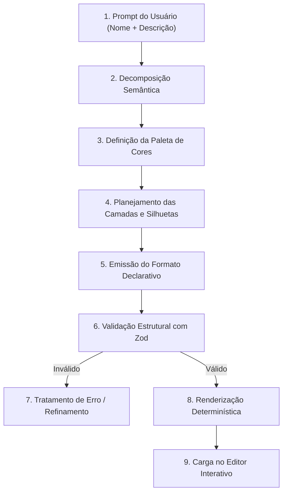

# PixelForge AI — Estratégia de Geração com LLM

## 1. Visão Geral

Modelos de Linguagem de grande escala (LLMs) possuem alta capacidade de raciocínio espacial abstrato e composição semântica, mas são ineficientes ao tentar produzir matrizes densas e cruas de pixels. Se solicitarmos uma imagem crua de 128x128 em formato JSON com cada pixel individual, a saída exigiria mais de 16.000 nós de dados, estourando a janela de contexto, gerando latência inaceitável e alto risco de truncamento.

A estratégia do **PixelForge AI** transforma a geração em um processo de **composição geométrica declarativa**, no qual a LLM atua como um artista técnico planejando paleta, proporções, camadas e primitivas.

---

## 2. Pipeline de Geração Progressiva



### Etapas do Pipeline:

1. **Decomposição Semântica**:
   - A LLM analisa o tema (ex.: "Dragão Verde de Fogo"), define o enquadramento (centrado, lateral, 3/4) e determina a resolução lógica mais apropriada (16x16, 32x32 ou 64x64).
2. **Harmonização da Paleta**:
   - Criação de uma rampa de cores consistente: cor de fundo, cor de contorno escura, tons de sombra, tom base, tom de iluminação (*highlight*) e cores de destaque (*accents*).
3. **Estruturação de Camadas**:
   - Separação em camadas lógicas: `background`, `shadows`, `silhouette`, `details`, `outline`.
4. **Geração por Primitivas**:
   - A LLM utiliza retângulos (`rect`), círculos (`circle`) e linhas (`line`) para definir a massa principal da figura, e pontos individuais (`points`) para olhos, brilhos e texturas de 1 pixel.
5. **Validação Zod**:
   - O schema Zod inspeciona o JSON. Quaisquer cores indefinidas na paleta ou campos ausentes são capturados antes da renderização.

---

## 3. Arquitetura de Provedores (Ports and Adapters)

A camada de domínio comunica-se com a geração de IA exclusivamente pela interface `PixelArtAIProvider`:

```typescript
interface PixelArtAIProvider {
  generatePixelArt(
    request: PixelArtGenerationRequest
  ): Promise<PixelArtGenerationResult>;
}

interface PixelArtGenerationRequest {
  name: string;
  description: string;
  logicalWidth: number;
  logicalHeight: number;
  paletteTheme?: string;
}

interface PixelArtGenerationResult {
  success: boolean;
  declarativeArt?: DeclarativePixelArt;
  error?: string;
  tokenUsage?: {
    promptTokens: number;
    completionTokens: number;
    totalTokens: number;
  };
}
```

### Implementações:
1. `MockPixelArtAIProvider`:
   - Gera artes geométricas de alta qualidade com algoritmos programáticos puros. Permite desenvolvimento sem consumo de tokens e testes de integração determinísticos.
2. `HttpProxyAIProvider`:
   - Conecta-se a um proxy de backend (ex.: `/api/generate-pixel-art`) que mantém chaves secretas de provedores (OpenAI, Anthropic, Gemini, Groq) em ambiente de servidor, mantendo o frontend seguro.

---

## 4. Instruções do System Prompt para a LLM

Quando uma LLM real é invocada via backend, o seguinte direcionamento é fornecido:

1. **Saída JSON Estrita**: Responda exclusivamente com um objeto JSON válido, sem cercas de markdown adicionais ou texto explicativo.
2. **Respeito aos Limites**: Todas as coordenadas `x` e `y` devem situar-se no intervalo `[0, logicalWidth - 1]` e `[0, logicalHeight - 1]`.
3. **Consistência de Paleta**: Utilize somente identificadores de cor declarados explicitamente no bloco `palette`.
4. **Contraste e Legibilidade**: Empregue pelo menos 3 tons por material (sombra, tom médio, luz) e um contorno escuro para preservar a estética clássica de pixel art.
5. **Uso de Simetria**: Em personagens frontais ou itens simétricos, utilize a operação `symmetry_h` para otimizar tokens e garantir proporção equilibrada.

