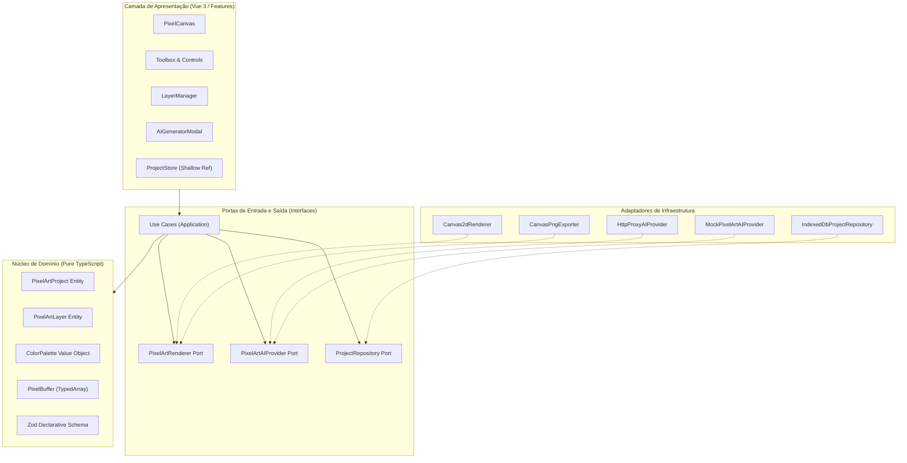

# PixelForge AI — Arquitetura de Software

## 1. Visão Arquitetural

A arquitetura do **PixelForge AI** adota os princípios de **Clean Architecture**, **Hexagonal Architecture (Ports and Adapters)** e **Domain-Driven Design (DDD)**. 

O objetivo central é garantir que a lógica do domínio de Pixel Art, as operações de desenho e o motor de renderização sejam completamente isolados de frameworks visuais (Vue 3), bibliotecas externas e provedores de Inteligência Artificial.



---

## 2. Princípios Norteadores

1. **Independência de Framework**: O núcleo de regras (`core/`) não importa Vue, Pinia, React ou qualquer elemento do DOM. Ele pode ser executado em Node.js, Web Worker ou em outro frontend.
2. **Determinismo**: Uma mesma entrada de dados estruturada produz rigorosamente o mesmo resultado visual em qualquer plataforma ou navegador.
3. **Imutabilidade e Eficiência de Estado**: O estado do editor separa metadados reativos (como zoom, seleção de ferramenta, paleta ativa) dos buffers binários de pixels lógicos (gerenciados com `Uint8ClampedArray` e `Uint32Array`).
4. **Isolamento de IA**: Provedores de LLM são detalhes de infraestrutura acessados via adapters. O domínio não conhece Groq, OpenAI ou Anthropic.
5. **Segurança por Design**: Nenhum dado vindo de fora (JSON importado ou resposta de LLM) entra no renderizador sem validação estrita prévia via esquemas Zod.

---

## 3. Estrutura de Diretórios

```text
src/
├── app/
│   ├── components/       # Componentes estruturais globais
│   ├── composables/      # Hooks de UI (ex.: useCanvasEvents, useKeyboardShortcuts)
│   ├── layouts/          # Layout do workspace e barras laterais
│   ├── pages/            # Visões principais (EditorView, ProjectSelectionView)
│   ├── stores/           # Gerenciamento de estado de UI (Pinia/ShallowRef)
│   └── router/           # Roteamento da aplicação
│
├── core/
│   ├── domain/
│   │   ├── pixel-art/    # Entidades: PixelArtProject, Dimensions, Metadata
│   │   ├── palette/      # Entidades e Value Objects: ColorPalette, Color
│   │   ├── layer/        # Entidades: PixelArtLayer, BlendMode
│   │   ├── canvas/       # Estruturas: PixelBuffer (Uint32Array), Coordenadas
│   │   └── validation/   # Esquemas Zod do formato declarativo intermediário
│   │
│   ├── application/
│   │   ├── use-cases/    # Casos de uso da aplicação
│   │   │   ├── CreateProjectUseCase.ts
│   │   │   ├── RenderProjectUseCase.ts
│   │   │   ├── ApplyToolOperationUseCase.ts
│   │   │   ├── GeneratePixelArtUseCase.ts
│   │   │   ├── ExportPngUseCase.ts
│   │   │   ├── ExportJsonUseCase.ts
│   │   │   └── ImportJsonUseCase.ts
│   │   └── services/     # Serviços de domínio orquestradores
│   │
│   └── ports/            # Interfaces de saída (DIP - Dependency Inversion)
│       ├── ai-provider/  # PixelArtAIProvider
│       ├── renderer/     # PixelArtRenderer, PngExporter
│       └── persistence/  # ProjectRepository
│
├── infrastructure/
│   ├── ai/               # Implementações concretas de IA (Mock, HTTP Proxy)
│   ├── renderer/         # Renderizador Canvas 2D nativo e algoritmos
│   ├── persistence/      # Implementação IndexedDB (idb)
│   └── export/           # Implementação de exportação PNG
│
├── features/
│   ├── pixel-art-editor/ # Telas e componentes do editor interativo
│   ├── pixel-art-generator/# Interface de prompt e geração assistida por IA
│   ├── palette-editor/   # Seletor e gerenciador de paletas de cores
│   ├── layer-editor/     # Gerenciador de camadas (visibilidade, zIndex)
│   └── project-management/# Listagem, criação, duplicação e exclusão de projetos
│
├── shared/
│   ├── components/       # Componentes reutilizáveis (botões, inputs, modais)
│   ├── constants/        # Configuração centralizada (APP_CONFIG) e paletas padrão
│   ├── utils/            # Utilitários de cor (HEX/RGBA), Bresenham, Flood Fill
│   └── types/            # Tipos utilitários compartilhados
│
└── workers/              # Web Workers para processamento pesado e exportação
```

---

## 4. Camadas da Aplicação

### 4.1. Core Domain
Contém as entidades fundamentais do negócio:
- `PixelArtProject`: Agregado raiz que une dimensões, paleta de cores, lista ordenada de camadas e metadados.
- `PixelArtLayer`: Unidade visual com identificador, nome, visibilidade, opacidade, zIndex e um buffer de pixels.
- `ColorPalette`: Conjunto nomeado de cores hexadecimais semânticas e mapeamento para RGBA de 32 bits.
- `PixelBuffer`: Abstração de alto desempenho sobre `Uint32Array` de tamanho `logicalWidth * logicalHeight`. Permite ler e gravar pixels com complexidade O(1) e sem alocação de objetos em tempo de execução.

### 4.2. Core Application (Casos de Uso)
Orquestra os fluxos da aplicação implementando casos de uso específicos:
- Cada caso de uso possui uma responsabilidade única (Single Responsibility Principle).
- Exemplos: `ApplyToolOperationUseCase` recebe uma ferramenta (lápis, borracha, balde), uma camada de destino, uma coordenada lógica e uma cor, aplicando a modificação diretamente no buffer e disparando a renderização necessária.

### 4.3. Ports (Interfaces)
Define os contratos que a infraestrutura deve satisfazer:
- `PixelArtRenderer`: Define os métodos `render(project: PixelArtProject): Promise<ImageBitmap | ImageData>` e `renderToCanvas(targetCanvas: HTMLCanvasElement, project: PixelArtProject): void`.
- `PixelArtAIProvider`: Define `generatePixelArt(request: PixelArtGenerationRequest): Promise<PixelArtGenerationResult>`.
- `ProjectRepository`: Define métodos CRUD assíncronos (`save`, `getById`, `listAll`, `delete`, `duplicate`).

### 4.4. Infrastructure (Adaptadores)
Implementa os contratos usando tecnologias específicas:
- `Canvas2dRenderer`: Usa Canvas 2D nativo com `imageSmoothingEnabled = false` para desenhar o buffer lógico e projetá-lo no canvas de visualização e no canvas de saída (1024x1024) com escala *nearest-neighbor*.
- `IndexedDbProjectRepository`: Utiliza IndexedDB para armazenamento local durável de projetos.
- `HttpProxyAIProvider`: Comunica-se com endpoint seguro de backend para geração de artes, sem expor chaves no cliente.
- `MockPixelArtAIProvider`: Provedor determinístico para testes e uso offline sem dependência de chaves de API externas.

### 4.5. Presentation / Features (Vue 3)
A camada visual usa Vue 3 com Composition API e TypeScript:
- Os componentes são orientados a apresentação e interação.
- A reatividade do Vue nunca é aplicada diretamente aos buffers de pixels para evitar sobrecarga de proxies reativos. O buffer reside em instâncias controladas com `shallowRef`.
- Toda interação do usuário gera chamadas diretas a Casos de Uso ou ao gerenciador de histórico (Undo/Redo).

---

## 5. Fluxo de Execução e Ciclo de Vida dos Dados

### 5.1. Fluxo de Edição Manual
1. Usuário clica ou arrasta o mouse no `PixelCanvas`.
2. O componente converte as coordenadas de viewport da tela `(clientX, clientY)` para coordenadas da grade lógica `(logicalX, logicalY)`.
3. O `ApplyToolOperationUseCase` é invocado com a ferramenta selecionada (Lápis, Linha, Retângulo, Balde).
4. O buffer da camada ativa é atualizado diretamente via TypedArray.
5. O renderizador compõe as camadas ativas e atualiza o Canvas da tela em menos de 1ms.
6. A operação é registrada na pilha de Undo/Redo como um comando reversível.

### 5.2. Fluxo de Geração por LLM
1. Usuário informa nome da arte, descrição textual, dimensões lógicas e restrições.
2. A requisição é processada pelo `GeneratePixelArtUseCase`.
3. O `PixelArtAIProvider` é consultado e retorna a estrutura intermediária declarativa.
4. O esquema Zod (`PixelArtFormatSchema`) valida a estrutura retornada.
5. Se inválido, o erro é tratado com detalhes para ajuste ou repetição da solicitação.
6. Se válido, o interpretador converte o formato declarativo em um novo `PixelArtProject` contendo camadas e pixels calculados determinísticamente.
7. O renderizador gera a imagem no canvas e o projeto é salvo automaticamente no repositório.

### 5.3. Fluxo de Exportação PNG (1024x1024)
1. Usuário clica em "Exportar PNG".
2. O `ExportPngUseCase` instancia um `OffscreenCanvas` com as dimensões de saída configuradas (1024x1024).
3. O contexto de renderização aplica `imageSmoothingEnabled = false`.
4. Cada camada visível é composta com base em sua opacidade.
5. A imagem lógica é projetada no canvas de 1024x1024 usando escala inteira *nearest-neighbor*.
6. O canvas gera um Blob PNG de alta resolução e dispara o download no navegador.

