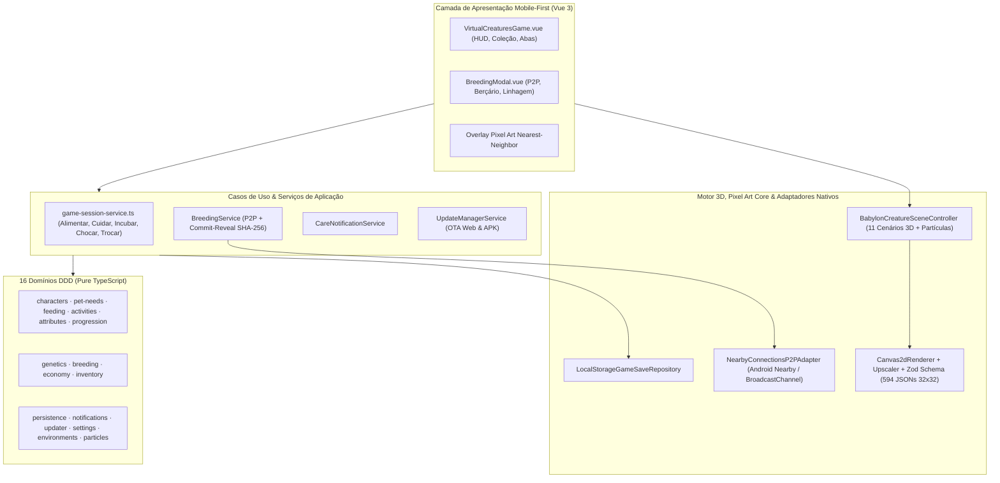

# PixelForge Virtual Creatures — Arquitetura de Software (`ARCHITECTURE.md`)

## 1. Visão Arquitetural

A arquitetura do jogo **PixelForge Virtual Creatures** adota **Clean Architecture**, **Hexagonal Architecture (Ports and Adapters)** e **Domain-Driven Design (DDD) Modular**.

O propósito central é manter todas as regras de sobrevivência, necessidades, dietas, evolução, genética, reprodução P2P, notificações e persistência em TypeScript puro — desacopladas da UI em Vue 3, do motor 3D em Babylon.js e dos plugins nativos do Capacitor Android.

---

## 2. Princípios Norteadores

1. **Independência de Framework**: As engines em `src/domains/*/domain/` e `src/core/domain/` são funções puras sem dependência de Vue, DOM ou Babylon.js.
2. **Simulação Temporal Determinística (`ClockPort`)**: Toda evolução, decaimento de necessidades e progresso de incubação recebe `nowMs` explícito para suportar simulação offline fiel e testes 100% determinísticos.
3. **Preservação Integral da Pixel Art (`32×32`)**: Os 594 JSONs declarativos passam por validação Zod estrita e são rasterizados sem borramento (`NEAREST_SAMPLINGMODE`), aceitando overrides genéticos não destrutivos em memória.
4. **Segurança P2P e Propriedade Única de Ovos**: O protocolo `Commit-Reveal SHA-256` garante sorteio justo entre pares sem servidor central, e o vínculo ao `playerId` local + ID único de instância (`collection`) previne duplicações ou perda de progenitores.
5. **Fronteiras Verificadas Automatizadamente**: Validado continuamente por `dependency-cruiser` (`.dependency-cruiser.cjs`) e [`src/shared/architecture.spec.ts`](../src/shared/architecture.spec.ts).
