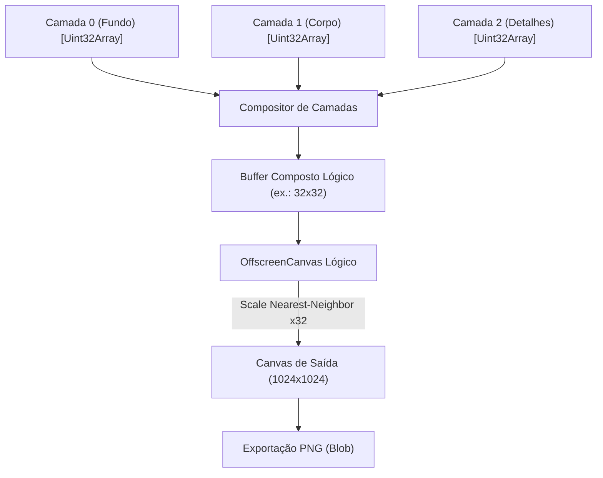

# PixelForge AI — Especificação do Renderizador Determinístico

## 1. Visão Geral

O renderizador do **PixelForge AI** é um motor gráfico determinístico e puro baseado em Canvas 2D nativo e buffers de memória de baixo nível (`Uint32Array` e `Uint8ClampedArray`). Ele é responsável por interpretar o formato declarativo intermediário, processar operações manuais de desenho e produzir imagens fiéis pixel a pixel, tanto na visualização em tempo real do editor quanto na exportação final de alta resolução (1024x1024).

---

## 2. Princípios de Renderização

1. **Determinismo**: Uma mesma lista de operações executada sobre uma camada deve produzir exatamente os mesmos valores binários de RGBA em qualquer arquitetura de hardware ou sistema operacional.
2. **Sem Interpolação**: O motor desativa categoricamente qualquer interpolação bilinear ou bicúbica (`ctx.imageSmoothingEnabled = false`), preservando a borda nítida de cada pixel lógico.
3. **Alto Desempenho**: Leitura e escrita de pixels em O(1) através de mapeamento linear `index = y * logicalWidth + x` em arrays tipados contíguos de 32 bits em formato Little-Endian (`0xAABBGGRR`).
4. **Composição em Camadas**: Cada camada possui seu próprio buffer de pixels e propriedades de opacidade (`0.0` a `1.0`), visibilidade (`boolean`) e ordenação (`zIndex`).

---

## 3. Estrutura do Buffer de Pixels (`PixelBuffer`)

Cada camada lógica do projeto aloca um `PixelBuffer` que encapsula:
- Um `ArrayBuffer` contíguo de tamanho `logicalWidth * logicalHeight * 4` bytes.
- Uma visualização `Uint32Array` para escrita e leitura atômica de pixels em uma única instrução de processador.
- Uma visualização `Uint8ClampedArray` compatível diretamente com `ImageData(data, width, height)` da Canvas API.

```text
Coordenada (x, y) ───> index = y * logicalWidth + x
Uint32Array: [ 0x00000000, 0xFF14532D, 0xFF7CFC00, ... ]
Uint8ClampedArray (RGBA bytes): [ R, G, B, A, R, G, B, A, ... ]
```

---

## 4. Algoritmos de Rasterização Discreta

### 4.1. Algoritmo de Bresenham para Linhas
Garante linhas retas sem gaps e sem interpolação em grades de inteiros discretos, calculando o erro acumulado a cada incremento no eixo dominante.

### 4.2. Algoritmo de Ponto Médio de Bresenham para Círculos
Calcula arcos e círculos perfeitos em coordenadas discretas, com suporte a preenchimento sólido traçando linhas horizontais entre os pares de coordenadas calculadas em cada octante.

### 4.3. Flood Fill com Scanline Stack
Algoritmo iterativo baseado em pilha (evitando estouro de call stack recursivo) que preenche áreas contíguas da mesma cor percorrendo segmentos horizontais contínuos (*spans*).

---

## 5. Pipeline de Composição e Escala (1024x1024)



### Passos de Composição:
1. Um buffer resultante `Uint32Array` de dimensões `logicalWidth * logicalHeight` é inicializado limpo (totalmente transparente: `0x00000000`).
2. As camadas visíveis são iteradas em ordem crescente de `zIndex`.
3. Para cada pixel `(x, y)`, se a opacidade da camada for `1.0` e o pixel não for transparente, o pixel da camada sobrepõe o pixel inferior. Se houver opacidade parcial, é executada a fórmula de mistura alfa linear padrão (*Alpha Blending*).
4. O buffer resultante é transferido para um `ImageData` no canvas lógico.
5. O canvas lógico é desenhado no canvas de saída (1024x1024) com `ctx.drawImage` e `ctx.imageSmoothingEnabled = false`, garantindo fator de escala exato:
   - Grade 16x16: fator 64x (cada pixel lógico vira um bloco 64x64).
   - Grade 32x32: fator 32x (cada pixel lógico vira um bloco 32x32).
   - Grade 64x64: fator 16x (cada pixel lógico vira um bloco 16x16).
   - Grade 128x128: fator 8x (cada pixel lógico vira um bloco 8x8).

