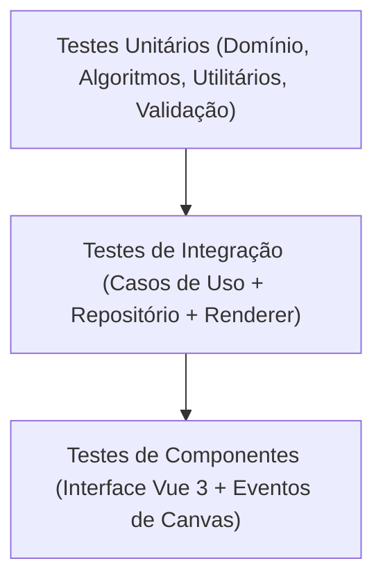

# PixelForge AI — Estratégia de Testes e Qualidade

## 1. Visão Geral

A suíte de testes do **PixelForge AI** adota o **Vitest** como executor de testes de alta performance integrado ao pipeline do Vite. A meta estabelecida é alcançar **100% de cobertura** (statements, branches, functions e lines) nos módulos críticos da aplicação:
- Núcleo de Domínio (`src/core/domain/**`)
- Validações Zod (`src/core/domain/validation/**`)
- Motor de Renderização e Algoritmos (`src/infrastructure/renderer/**`)
- Casos de Uso da Aplicação (`src/core/application/use-cases/**`)

---

## 2. Pirâmide e Tipos de Testes



### 2.1. Testes Unitários de Domínio
- Criação e mutação de entidades (`PixelArtProject`, `PixelArtLayer`, `ColorPalette`).
- Operações de leitura e escrita atômica no `PixelBuffer`.
- Conversão de cores entre representação Hexadecimal (#RRGGBB, #RRGGBBAA) e inteiros RGBA de 32 bits Little-Endian.

### 2.2. Testes dos Algoritmos de Rasterização
- **Bresenham Line**: validação de trajetórias horizontais, verticais, diagonais de 45° e ângulos arbitrários.
- **Bresenham Circle**: validação de simetria nos 8 octantes, verificação de preenchimento completo e contenção estrita no raio.
- **Flood Fill**: preenchimento de áreas fechadas simples, formas côncavas, limites da imagem e prevenção de loops infinitos.

### 2.3. Testes de Validação do Formato Declarativo (Zod)
- Validação de arte completa válida.
- Rejeição de formatos com referências a cores ausentes na paleta.
- Rejeição de valores fora dos limites e tipagens incorretas.
- Validação de operações aninhadas de simetria.

### 2.4. Testes do Renderizador
- Validação da composição multicamada com ordenação por `zIndex`.
- Validação de preservação de transparência (`alpha = 0`).
- Teste de escala *nearest-neighbor* projetando buffers lógicos no canvas de 1024x1024.

### 2.5. Testes de Casos de Uso
- Execução isolada dos fluxos com mocks de portas (`PixelArtAIProvider`, `ProjectRepository`).
- Validação de chamadas, tratamento de exceções e integridade de retornos.

---

## 3. Comandos de Execução

```bash
# Executa todos os testes em modo watch
pnpm test

# Executa todos os testes em execução única (CI)
pnpm test:run

# Executa testes gerando relatório de cobertura
pnpm test:coverage

# Executa verificação de tipos estáticos sem emitir código
pnpm typecheck

# Executa análise estática de código com ESLint
pnpm lint
```

---

## 4. Políticas de Qualidade e Proibições

1. **Proibição de `any`**: Nenhuma asserção ou tipagem deve recorrer a `any`. Usar tipos discriminados, genéricos ou `unknown` com validação de tipo.
2. **Determinismo dos Testes**: Nenhum teste pode depender de conexões externas de rede ou temporizadores não controlados.
3. **Mocks Estritos**: Provedores de IA externos devem ser testados exclusivamente através de implementações de mock (`MockPixelArtAIProvider`) ou fixtures controladas.

